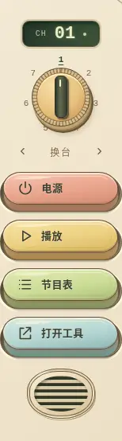

# 控件实机裁切：审查对象，不是新设计

下图来自本轮Chromium加载的V3实际页面，截取右侧控制列，再转换为154×554的WebP观察图。未使用生成图，未修补按钮。输入是证据README所列V3；为了静态比较使用测试停帧，所以播放键显示“播放”。

图像7162字节，SHA-256：`2d94b79aaa3fb1831f27330a6c836ea96e7dc53419e2f961b86c46de98df289c`。这是有损观察图，不用于逐像素保真测试。

## 具体看哪里

1. 四键都有完整色面与双重边缘，按钮本身的色彩比状态更显眼；青蓝色第四键尤其与暖机壳分离。
2. 旋钮环纹路密、刻度小；扬声器轮廓细、横条粗。两者不需相同尺寸，却需要同一组安装、线重和材质规则。
3. 键帽顶面已有高光和侧壁，并非缺立体结构；继续叠阴影无法解决造型家族问题。
4. 菜单、外链、电源图标虽然可识别，仍应作为一组实体印刷标识检查笔画、视觉尺寸与基线。

推荐方案详见[设计D04](../design.md)，它尚未批准，也未在这张图中实现。整机、手机和32幅分幕观察图已在本轮本地检查；未在此目录保存的完整媒体不宣称已入GitHub，完整交付包另附。
